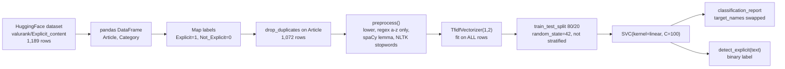
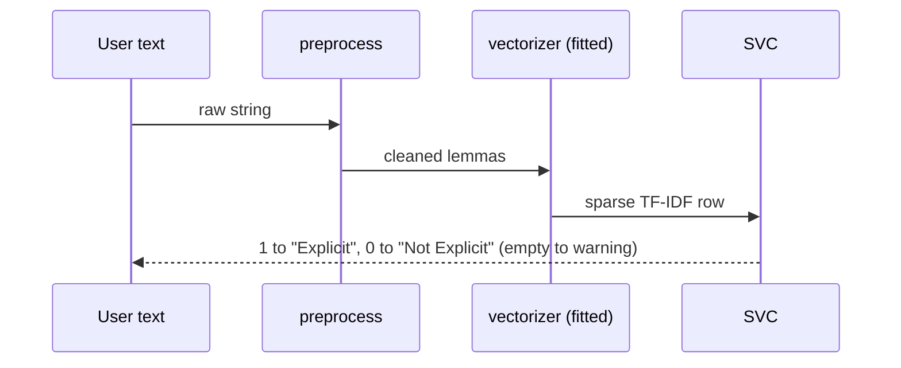

# Explicit-Text-Classifier — Interview Deep-Dive

> **Who this is for:** me (the author), preparing to explain and defend this project in ML interviews.
> **How to read it:** plain English first, then technical depth. Every term is defined on first use, and there's a [Glossary](#glossary) at the end.
> **Ground rules:** checked against `Explicit Content Classifier.ipynb` (cells and saved outputs), `README.md` and the git history (HEAD `ef0946c`). Anything not evidenced is marked **UNVERIFIED**.

---

## 0. TL;DR

- **What:** a Jupyter notebook that trains a **TF-IDF + linear SVM** text classifier on the HuggingFace dataset `valurank/Explicit_content` (news-style articles labelled `Explicit` / `Not_Explicit`). Preprocessing: lowercase, strip non-letters, spaCy lemmatise, NLTK stopwords. Then an 80/20 split and a `classification_report`.
- **The single most important fact:** the README says *"Precision (explicit class) 0.86, Recall (explicit class) 0.96"*. **That's wrong. Those are the scores of the *Not-Explicit* class.**
  - Cell 11 calls `classification_report(..., target_names=['positive', 'negative'])`. sklearn assigns names in sorted label order, so **label 0 (Not_Explicit) is printed as "positive"** and label 1 (Explicit) as "negative".
  - The supports prove it: "positive" has 151 test rows and "negative" has 64. The full dataset is 757 class-0 vs 315 class-1 (cell 7 output), so the larger group must be class 0.
  - **Actual explicit-class performance (cell 11 output): precision 0.87, recall 0.62, F1 0.73.** Overall accuracy 0.86, macro-F1 0.82.
- **Also:** the README describes **hard-negative training** and a **3-tier confidence threshold** on `decision_function` (> 0.8 / 0.3–0.8 / < 0.3). **Neither exists in the notebook.** That README was rewritten in May 2026 by a commit authored "Antigravity" (an AI coding agent), about a year after the notebook was committed. The "high recall" design story rests on the mislabelled number.

---

## 1. One-paragraph pitch (30 seconds)

"It's a classical NLP baseline for flagging explicit content in articles. I clean the text, lemmatise with spaCy, remove stopwords, build TF-IDF features over unigrams and bigrams, and train a linear-kernel SVM. On a held-out 20% split of about 1,070 de-duplicated articles it gets 86% accuracy. For the explicit class specifically, it's precise (0.87) but misses more than a third of explicit articles (recall 0.62). That's the main thing I'd fix, with class weighting, threshold tuning on the SVM margin, and ultimately a fine-tuned transformer, because bag-of-words can't distinguish *discussing* explicit content from explicit content."

*(This is the honest version. Don't use the README's 0.96 recall. See §8.)*

---

## 2. Plain-language explanation

**The problem.** Websites need to automatically flag articles that contain explicit or disturbing material, so a person can review or hide them. Doing that by hand doesn't scale.

**The approach (a "word-counting" classifier).**
1. **Clean** each article: lowercase, remove punctuation and numbers, turn words into their dictionary form ("running" → "run"; this is called *lemmatising*), and drop very common words like "the" and "is" (*stopwords*).
2. **Turn text into numbers** with **TF-IDF**. Each word or two-word phrase gets a score that is high if it's frequent *in this article* but rare *across all articles*. So distinctive words stand out.
3. **Train an SVM** (support vector machine), a classic algorithm that finds the best dividing line between the two groups in this huge word-space.
4. **Test** on 20% of articles the model never saw.

**The honest result.** When the model says "explicit", it's right about 87% of the time. But it only catches about 62% of the explicit articles. In content moderation, missing explicit content is usually the costlier error, so that's the number to improve.

**Why it struggles.** It only sees *which words appear*, not what the sentence means. "The platform removed sexually explicit posts" (a news story about moderation) and actually explicit text share words.

---

## 3. Architecture

### 3.1 Pipeline



### 3.2 Inference path



There is no server, API or saved model. Everything lives in the notebook's kernel memory.

---

## 4. Tech stack

| Tool | Role | Why | Alternatives |
|---|---|---|---|
| `datasets` (HF) | `load_dataset("valurank/Explicit_content")` | One-line download | Manual CSV |
| pandas | DataFrame ops, label mapping, dedupe | Standard | polars |
| `re` | `[^a-z\s]` filter | Simple | spaCy tokeniser only |
| **spaCy** `en_core_web_sm` | Lemmatisation | Better lemmas than Porter stemming | NLTK WordNetLemmatizer (faster, cruder); no lemmatisation (TF-IDF bigrams often do fine without) |
| **NLTK** stopwords | Stopword list | Standard list | spaCy's stopword list; none (let IDF down-weight them) |
| **scikit-learn** `TfidfVectorizer`, `SVC`, `train_test_split`, `classification_report` | Features, model, eval | Classic, strong baseline for text | `LinearSVC` (much faster for linear kernels on sparse data), `LogisticRegression` (gives probabilities), Naive Bayes; DistilBERT/RoBERTa fine-tuning |
| matplotlib/seaborn | Listed in the README install line but **not used** in the notebook | — | — |

---

## 5. Code walkthrough (cell by cell)

> Execution counts are out of order (cells ran as 94, 120, 126, **138**, 128, **139**, …). The saved outputs reflect a kernel state built from non-linear execution. E.g. cell 3's output already shows a `clean_text` column, which cell 5 creates later.

| Cell | What it does | Notes |
|---|---|---|
| 0 | Imports; `nltk.download('stopwords')`; `spacy.load("en_core_web_sm")` | Output shows a Windows path `C:\Users\Akhil\…`, so it was run on a machine with user "Akhil" |
| 1–2 | `load_dataset` → `ds['train'].to_pandas()` | Only a `train` split is used |
| 3 | Map `Explicit` → 1, `Not_Explicit` → 0, cast to int | Output shows 1,189 index entries |
| 4 | **`preprocess(text)`**: lowercase → `re.sub(r'[^a-z\s]', '', text)` → spaCy → keep `token.lemma_` if `token.text` not in stopwords/punctuation | Regex runs **before** spaCy: contractions break ("didn't" → "didnt"), numbers vanish, sentence boundaries go. Stopword check uses the *surface* form, then emits the *lemma*. Negations like "not" are NLTK stopwords, so they're removed |
| 5 | `drop_duplicates(subset=['Article'])`, then apply `preprocess` | Prints `df.size` = 3216 both before and after (rows × 3 columns = 1,072 rows). Dedupe had already happened in an earlier run |
| 7 | `value_counts`: **0 → 757, 1 → 315** | ~29% positive, so imbalanced |
| 8 | `TfidfVectorizer(ngram_range=(1,2))` **fit on the full dataset** | Vocabulary and IDF use test documents: mild transductive leakage |
| 10 | `train_test_split(X, y, test_size=0.2, random_state=42)` → `SVC(kernel='linear', C=100)` | **Not stratified**. **C=100** means very weak regularisation on ~860 training docs with a huge bigram vocabulary. No CV or tuning |
| 11 | `classification_report(y_test, y_pred, target_names=['positive','negative'])`, plus first `detect_explicit` | **Names swapped** (see §0). "She trembled as he gently ran his fingers…" → Not Explicit |
| 12 | Second `detect_explicit`: empty-input guard, binary label | Returns a **string only**. The README's `label, score = detect_explicit(text)` would fail |
| 14 | Re-splits *raw* texts with the same `random_state` to print each test article with true vs predicted label | Works only because the row count and seed match. Fragile. Prints the whole test set |

---

## 6. Core concepts & theory

### 6.1 TF-IDF
- **Term frequency** $tf(t,d)$ is the count of term *t* in document *d*.
- **Inverse document frequency.** sklearn's default (`smooth_idf=True`) is $idf(t) = \ln\frac{1+n}{1+df(t)} + 1$.
- The weight is $w_{t,d} = tf \cdot idf$, and then each document vector is L2-normalised (`norm='l2'`).
- **Bigrams** capture short phrases ("sexual assault" ≠ "assault"), but they blow up the vocabulary. With `min_df=1` that's likely 100k+ features for about 1k documents, i.e. *p ≫ n*.

### 6.2 Linear SVM
- It finds $w, b$ that maximise the margin $2/\lVert w\rVert$ while penalising violations:
  $$\min_{w,b}\ \tfrac12\lVert w\rVert^2 + C\sum_i \max(0,\ 1 - y_i(w^\top x_i + b))$$
  The second term is the **hinge loss**.
- **C** trades margin width against training errors. Large C (100) means "fit the training set almost perfectly". With *p ≫ n*, the data is almost certainly linearly separable, so C hardly matters past a point. The model is effectively the hard-margin SVM, which risks overfitting.
- `decision_function` returns $w^\top x + b$, a **signed distance to the hyperplane**, not a probability. The README's thresholds of 0.3 and 0.8 on this score are arbitrary unless calibrated (Platt scaling via `CalibratedClassifierCV`, or `SVC(probability=True)`).
- `SVC(kernel='linear')` uses libsvm (a dual solver, roughly O(n²–n³)). `LinearSVC` (liblinear, primal) is the standard faster choice for sparse text.

### 6.3 Class imbalance & thresholds
- With 29% positives, a default threshold at 0 is not recall-optimal. Options:
  - `class_weight='balanced'` scales C per class by $n/(k\cdot n_c)$;
  - shift the threshold on `decision_function` using a precision-recall curve from validation;
  - resample.

### 6.4 Metrics
- **Precision** $=TP/(TP+FP)$, **Recall** $=TP/(TP+FN)$, $F_1 = 2PR/(P+R)$.
- **$F_\beta$** with β = 2 weights recall more, which suits moderation.
- **Reading a classification report:** rows are classes in sorted label order. `target_names` only *renames* them, so a wrong order silently swaps the labels.
- **PR-AUC** (average precision) is more informative than ROC-AUC on imbalanced data.

### 6.5 Why bag-of-words fails on meta-discussion
- TF-IDF is order-free and context-free. "Explicit content was removed" contains the same tokens as content that *is* explicit.
- Contextual encoders (BERT-family) represent each token conditioned on the whole sentence, so they can learn the difference between *mention* and *use*.

---

## 7. Data

- **Source:** HF `valurank/Explicit_content`, `train` split.
  - 1,189 rows (cell 3 index), with columns `Article` and `Category`.
  - **1,072 after de-duplication**: 757 Not_Explicit, 315 Explicit.
- **What "explicit" means here is ambiguous.** The first "Explicit" rows shown are news stories (a sentencing in Wisconsin, a southern-California rescue, political commentary). The label seems to mean *disturbing or sensitive news content* (crime, violence) rather than sexual content. The ad-hoc test sentences in cells 11–12 test *sexual* content, which is a different concept. **Clarify this before an interview.**
- **Preprocessing:** see cell 4. No length normalisation, no handling of very long articles.
- **Split:** a single random 80/20 split (215 test rows: 151 class 0, 64 class 1). Not stratified, no validation set, no CV.
- **Leakage:**
  1. The TF-IDF fit includes test docs (mild).
  2. Near-duplicates: only exact `Article` duplicates were removed. Syndicated news often appears in slightly edited form, which can inflate test scores.
  3. Hidden-state notebook execution: results depend on cell order.

---

## 8. Evaluation & results

**From the saved output of cell 11 (labels corrected):**

| Class | Precision | Recall | F1 | Support |
|---|---|---|---|---|
| Not Explicit (0), printed as "positive" | 0.86 | **0.96** | 0.91 | 151 |
| **Explicit (1)**, printed as "negative" | **0.87** | **0.62** | **0.73** | 64 |
| Accuracy | | | 0.86 | 215 |
| Macro avg | 0.86 | 0.79 | 0.82 | 215 |

- **Rough confusion matrix** (back-computed from these rounded numbers, so approximate): explicit recall 0.62 × 64 ≈ 40 TP and ≈ 24 FN; precision 0.87 means ≈ 6 FP. So about **24 explicit articles were missed** for every 6 false alarms. That's the opposite of the "high recall" story.
- **Baseline:** predicting "Not Explicit" for everything scores 151/215 = **70.2% accuracy**. The model's 86% is a real but modest lift. Accuracy is the wrong headline metric here.
- **Soundness:** a single unstratified split of 215 docs (64 positives), no CI. The 95% CI on recall 0.62 with n = 64 is roughly ±0.12. No CV, the vectoriser is fit on everything, and there's no hyper-parameter search.
- **Qualitative checks (cells 11–12):** 3 anecdotal sentences. "She trembled… candlelight" → Not Explicit, "…having sex…" → Explicit. These are single sentences, out of distribution relative to the news-article training data.

---

## 9. Design decisions & trade-offs

| Decision | Gained | Lost |
|---|---|---|
| TF-IDF + linear SVM | Fast, interpretable (inspect top-weighted n-grams), strong small-data baseline | No context; can't separate mention vs use |
| spaCy lemmatisation | Merges inflections | Slow (full pipeline incl. parser/NER for every article; could disable components); applied after destructive regex |
| Bigrams, `min_df=1` | Captures phrases | Huge sparse vocabulary; overfitting risk with C=100 |
| `SVC(kernel='linear')` instead of `LinearSVC` | Same model family | Much slower; no probabilities |
| Single notebook | Easy to share | Out-of-order execution; no saved artefacts; not reusable |
| No class weighting | Simplicity | Explicit recall only 0.62 |

---

## 10. Honest weaknesses

1. **Mislabelled headline metric.** The README reports the Not-Explicit class's P/R as the Explicit class's. The true explicit recall is 0.62, not 0.96.
2. **README describes features that don't exist** (hard negatives, 3-tier `decision_function` thresholds, `detect_explicit` returning `(label, score)`, file name `Explicit_Content_Classifier.ipynb` with underscores).
3. **The label concept is unclear and mismatched** with the qualitative tests (sexual-content sentences vs a news dataset).
4. **No stratification, CV, tuning, or class weighting.** C=100 is unjustified.
5. **TF-IDF fit before the split** (mild leakage).
6. **Out-of-order notebook execution** and hidden state. There are no saved models, so it can't be deployed.
7. **Preprocessing order** (regex before spaCy) degrades lemmatisation and kills negations and contractions.
8. **Tiny test set** (64 positives), so every metric has wide uncertainty.
9. **Provenance:** the notebook ran on a machine with user `Akhil` (cell 0 output), and the README was rewritten by an AI agent. Be clear about your own contribution.

---

## 11. How I'd improve it (prioritised)

| # | Change | Effort | Impact |
|---|---|---|---|
| 1 | **Fix the report:** `target_names=['Not Explicit','Explicit']` and correct the README numbers | 5 min | Honesty; avoids an interview disaster |
| 2 | sklearn `Pipeline(TfidfVectorizer, LinearSVC/LogReg)` + **stratified 5-fold CV** + grid over C, `min_df`, n-grams, `class_weight` | 0.5 day | Leak-free, tuned, with error bars |
| 3 | **Threshold tuning for recall:** calibrate (`CalibratedClassifierCV`), pick the threshold at a target recall (e.g. 0.9) from validation PR curves, *then* implement the 3-tier review band the README describes | 0.5 day | Matches the moderation objective |
| 4 | Report PR-AUC, F2, confusion matrix; majority-class baseline; bootstrap CIs | 2 hours | Proper evaluation |
| 5 | Near-duplicate detection (MinHash / TF-IDF cosine > 0.9) before splitting | 2 hours | Prevents inflated scores |
| 6 | Fix preprocessing: run spaCy on raw text with `disable=["parser","ner"]`, keep negations, or skip lemmatisation and compare | 2 hours | Cleaner features, 5–10× faster |
| 7 | Hard-negative set (moderation policies, legal text) as a separate *challenge* test set | 1 day | Measures the known failure mode |
| 8 | Fine-tune DistilBERT/RoBERTa with class weights; compare on the same CV folds | 1–2 days | Likely large recall gain on context-dependent cases |
| 9 | Export a script/package with a saved pipeline (`joblib`) and a small FastAPI endpoint | 0.5 day | Usable artefact |

---

## 12. How to run it

```bash
python -m venv venv && source venv/bin/activate
pip install pandas scikit-learn spacy nltk datasets jupyter
python -m spacy download en_core_web_sm
python -c "import nltk; nltk.download('stopwords')"
jupyter notebook "Explicit Content Classifier.ipynb"   # note: spaces in the real file name
```
Run cells **top to bottom** (the saved outputs came from out-of-order execution). Needs internet access to the HuggingFace Hub. **Env vars:** none (optionally `HF_HOME` for the cache).

---

## 13. Resume bullets (truthful)

- Built a **TF-IDF (uni+bigram) + linear-SVM** text classifier for explicit-content detection on ~1.1k news articles, with a spaCy/NLTK preprocessing pipeline; **86% accuracy, explicit-class precision 0.87 / recall 0.62** on a held-out 20% split.
- Diagnosed a **label-ordering error in the evaluation report** that had inverted the reported per-class metrics, and redesigned evaluation around **recall-oriented thresholding, stratified CV and PR-AUC** for moderation use. *(Claim the second half only once it's implemented.)*

> ⚠️ Remove "recall 0.96" from anything public.

---

## Glossary

- **NLP**: natural language processing.
- **Lemmatisation**: reducing a word to its dictionary form (better → good, running → run).
- **Stopwords**: very common words usually removed (the, is, and).
- **TF-IDF**: term frequency × inverse document frequency; a weighting that highlights distinctive words.
- **n-gram**: a sequence of n tokens (bigram = 2 words).
- **SVM**: support vector machine; finds a maximum-margin separating hyperplane.
- **C (SVM)**: regularisation trade-off; large C = less regularisation.
- **Decision function**: a signed distance to the SVM boundary (not a probability).
- **Precision / recall / F1**: of predicted positives, how many are right / of real positives, how many are found / their harmonic mean.
- **Stratified split**: a split that preserves class proportions.
- **PR-AUC**: area under the precision-recall curve.
- **Calibration**: making scores behave like true probabilities.
- **Hard negatives**: negative examples deliberately chosen to look like positives.
